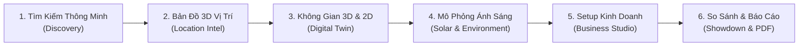

# SpaceVision BDS AI — Nền Tảng PropTech BĐS Thương Mại & 3D Digital Twin

[](https://vercel.com/new/clone?repository-url=https%3A%2F%2Fgithub.com%2Fliliustwocout%2FBDS)


> **SpaceVision BDS AI** là nền tảng PropTech thế hệ mới đột phá dành cho Bất động sản Thương mại (Commercial Real Estate - CRE). Dự án số hoá toàn diện quy trình khảo sát mặt bằng kinh doanh từ **Bản đồ 3D Đô thị GIS**, **Bản sao số 3D (Digital Twin)**, **Bản vẽ CAD 2D**, **Mô phỏng Môi trường & Chiếu sáng Thiên văn Hà Nội**, cho đến **AI Tư vấn Bố trí Không gian & Dự toán Ngân sách Đầu tư (CapEx)**.

---

## 🌟 Điểm Nhấn Đổi Mới UI/UX & Thiết Kế

1. **Phân Cấp Thị Giác Khoa Học (Visual Hierarchy)**:
   - Áp dụng triệt để quy chuẩn typography tối đa 3 cấp độ chữ trong một khung nhìn.
   - Loại bỏ hoàn toàn cảm giác ngợp thông tin, tạo khoảng thở thị giác (Visual Breathing Room) tối ưu cho nhà đầu tư.
2. **Quy Tắc 3 Giây Đầu (3-Second Rule)**:
   - Các thông số quyết định (*Giá thuê, Diện tích sàn, Mặt tiền, Điểm AI Match*) được phóng to cực đại dạng **Big Numbers** giúp người xem nắm bắt giá trị mặt bằng ngay lập tức.
3. **Công Bố Thông Tin Tăng Dần (Progressive Disclosure)**:
   - Danh sách dài, bộ lọc phức tạp, và các bảng dữ liệu kỹ thuật được thu gọn mặc định vào các thẻ Accordion tinh tế. Thông tin chỉ mở ra khi người dùng chủ động yêu cầu.
4. **Chế Độ Clean Architecture Mode (Phím tắt `L`)**:
   - Tính năng bật/tắt toàn bộ nhãn phòng bằng 1 cú nhấp hoặc nhấn phím **`L`**.
   - Tự động ẩn chữ khi xem toà nhà ở góc nhìn toàn cảnh để chiêm ngưỡng trọn vẹn kiến trúc mà không bị chữ che khuất.
5. **Khắc Phục Hoàn Toàn Xung Đột 2D/3D**:
   - Thanh công cụ và chú thích của bản vẽ 2D được nhúng hài hoà, loại bỏ hoàn toàn tình trạng chữ và nút bấm đè chồng lên nhau.

---

## 🚀 6 Phân Hệ Tính Năng Cốt Lõi



1. **Tìm Kiếm Nhu Cầu Kinh Doanh Bằng AI (`/discovery`)**:
   - Tìm kiếm bằng ngôn ngữ tự nhiên tiếng Việt (NLP). Tự động phân tích ngân sách, khu vực, ngành nghề và tiêu chí không gian.
   - Thẻ mặt bằng thông minh kèm nút kết nối nhanh qua Hotline / Zalo chính chủ.
2. **Bản Đồ 3D Đô Thị & Vị Trí GIS (`/location`)**:
   - Bản đồ vector MapLibre GL dựng khối toà nhà 3D (`fill-extrusion`) theo chiều cao thực tế.
   - Phân tích bán kính phục vụ $500\text{m} - 1\text{km} - 2\text{km}$ bằng Turf.js.
   - Định tuyến giao thông thực tế OSRM (Đi bộ, Xe máy, Ô tô) tới các tiện ích lân cận.
3. **Không Gian 3D Digital Twin & Mặt Bằng 2D CAD (`/twin`)**:
   - Mô hình 3D bóc tách từng tầng, 5 chế độ camera (Orbit, Dollhouse, Walkthrough, Top-down, Exterior).
   - Bản vẽ kỹ thuật 2D CAD chuẩn tỉ lệ 1:1, hiển thị tường, cửa mở xoay $90^\circ$, vách kính và la bàn hướng Bắc.
   - Chế độ xem song song 3D/2D (Split View).
4. **Mô Phỏng Môi Trường & Ánh Sáng Thiên Văn (`/environment`)**:
   - Thuật toán tính toán vị trí mặt trời chuẩn xác theo toạ độ Hà Nội ($21.0285^\circ\text{N}, 105.8542^\circ\text{E}$).
   - Chu kỳ thời gian 24 giờ và 365 ngày trong năm, hiển thị hướng đổ bóng thực tế.
   - Mô phỏng 3 trạng thái thời tiết (Nắng, Nhiều mây, Mưa) và bật đèn nội thất tự động ban đêm.
5. **AI Business Setup Studio (`/studio`)**:
   - Tự động sinh layout cho 8 mô hình kinh doanh (Café, Nhà hàng, Spa, Thời trang, Cửa hàng tiện lợi, Văn phòng, Showroom, Coworking).
   - 6 phong cách thiết kế nội thất (Minimalist, Scandinavian, Japanese, Industrial, Luxury, Modern).
   - Bóc tách dự toán ngân sách đầu tư CapEx (6 nhóm chi phí) và kiểm tra lối thoát nạn PCCC.
6. **Đối Chiếu Đa Mặt Bằng & Xuất Báo Cáo (`/comparison`)**:
   - So sánh song song tối đa 3 mặt bằng trên cùng một giao diện.
   - AI tự động đánh giá và gắn huy hiệu **Quán quân AI** cho mặt bằng tối ưu nhất.
   - Xuất báo cáo thẩm định in ấn / PDF chuyên nghiệp cho ban giám đốc và đối tác.

---

## 🛠️ Công Nghệ Sử Dụng (Tech Stack)

- **Framework**: Next.js 14.2 (App Router), React 18, TypeScript 5.6
- **Đồ hoạ 3D & WebGL**: Three.js 0.169, React Three Fiber 8.17, React Three Drei 9.114
- **Bản đồ GIS & Không gian**: MapLibre GL 4.7, Turf.js 7.1, Open Source Routing Machine (OSRM)
- **Quản lý Trạng thái**: Zustand 5.0
- **Giao diện & Hiệu ứng**: Tailwind CSS 3.4, Framer Motion 11.11, Lucide React Icons

---

## 📁 Cấu Trúc Thư Mục Dự Án

```
├── docs/                                # Tài liệu chi tiết dự án
│   ├── ARCHITECTURE.md                  # Kiến trúc hệ thống, data flow & 5 core engines
│   ├── USER_GUIDE.md                    # Hướng dẫn sử dụng 6 bước, phím tắt & spotlight tour
│   └── API_AND_DATA_MODELS.md           # Khai báo TypeScript types, thực thể & API route
├── public/                              # Tài nguyên tĩnh (ảnh, icons)
├── src/
│   ├── app/                             # Next.js App Router (11 static/dynamic routes)
│   │   ├── api/ai/route.ts              # API xử lý phân tích AI
│   │   ├── comparison/page.tsx          # Trang đối chiếu mặt bằng
│   │   ├── discovery/page.tsx           # Trang tìm kiếm AI
│   │   ├── environment/page.tsx         # Trang mô phỏng ánh sáng
│   │   ├── location/page.tsx            # Trang bản đồ 3D GIS
│   │   ├── studio/page.tsx              # Trang thiết kế & dự toán
│   │   └── twin/page.tsx                # Trang 3D Digital Twin & 2D CAD
│   ├── components/
│   │   ├── common/                      # Tour tương tác, modal hướng dẫn, liên hệ chủ nhà
│   │   ├── layout/                      # TopNav, AppLayout, thanh điều hướng chân trang
│   │   ├── map/                         # InteractiveMap (MapLibre GL 3D Extrusion)
│   │   ├── pages/                       # Component view cho từng trang nghiệp vụ
│   │   └── three/                       # BuildingDigitalTwin (R3F) & FloorPlan2D (SVG CAD)
│   ├── data/
│   │   └── demoProperties.ts            # Dữ liệu mặt bằng thực tế tại Cầu Giấy, Hoàn Kiếm, Đống Đa
│   ├── lib/
│   │   ├── aiEngine.ts                  # Thuật toán NLP, phân bổ layout, dự toán CapEx & PCCC
│   │   ├── building3dGeo.ts             # Toạ độ đa giác khối nhà Hà Nội
│   │   ├── geoUtils.ts                  # Tính khoảng cách Haversine & định tuyến OSRM
│   │   └── solarCalc.ts                 # Thuật toán thiên văn vị trí mặt trời theo toạ độ Hà Nội
│   ├── store/
│   │   └── useSpaceVisionStore.ts       # Zustand store quản lý trạng thái toàn cục
│   └── types/
│       └── index.ts                     # Hệ thống kiểu dữ liệu TypeScript
├── package.json
└── README.md
```

---

## ⌨️ Bảng Phím Tắt Nhanh

| Phím tắt | Tác vụ thực hiện |
| :---: | :--- |
| **`L`** | Bật / Tắt hiển thị nhãn tên phòng (Clean Mode) |
| **`1` - `6`** | Chuyển trực tiếp giữa 6 phân hệ nghiệp vụ |
| **`Chuột trái + Kéo`** | Xoay tự do góc nhìn 3D (Orbit Rotation) |
| **`Chuột phải + Kéo`**| Di chuyển camera (Pan) / Xoay nghiêng bản đồ (Pitch) |
| **`Cuộn chuột`** | Phóng to / Thu nhỏ mô hình (Zoom In/Out) |

---

## 💻 Hướng Dẫn Cài Đặt & Chạy Cục Bộ

### 1. Yêu cầu môi trường
- Node.js phiên bản $\ge 18.18.0$
- Trình quản lý gói `npm` hoặc `pnpm`

### 2. Cài đặt các thư viện phụ thuộc
```bash
npm install
```

### 3. Chạy môi trường phát triển (Development)
```bash
npm run dev
```
Mở trình duyệt tại địa chỉ `http://localhost:3000`.

### 4. Kiểm tra kiểu & Biên dịch sản phẩm (Production Build)
```bash
# Kiểm tra kiểu TypeScript
npm run typecheck

# Biên dịch sản phẩm
npm run build

# Chạy bản dựng sản phẩm
npm run start
```

---

## 📚 Tài Liệu Kỹ Thuật Bổ Sung

Để tìm hiểu sâu hơn về kiến trúc và cách phát triển dự án, vui lòng tham khảo các tài liệu trong thư mục [`docs/`](./docs/):
- 📘 [Kiến Trúc Hệ Thống (Architecture Guide)](./docs/ARCHITECTURE.md)
- 📗 [Hướng Dẫn Sử Dụng Chi Tiết (User Manual)](./docs/USER_GUIDE.md)
- 📙 [Mô Hình Dữ Liệu & API (Data Models & API Reference)](./docs/API_AND_DATA_MODELS.md)

---

## 📄 Bản Quyền & Giấy Phép

Phát triển bởi đội ngũ **SpaceVision BDS AI**. Bản quyền © 2026. Mọi quyền được bảo lưu.
