# Kiến Trúc Hệ Thống SpaceVision BDS AI (System Architecture)

> **SpaceVision BDS AI** là nền tảng PropTech thế hệ mới dành cho Bất động sản Thương mại (Commercial Real Estate - CRE), kết hợp giữa **GIS 3D Extrusions**, **Mô hình Bản sao số 3D (Digital Twin)**, **Bản vẽ kỹ thuật 2D CAD**, **Mô phỏng Môi trường & Chiếu sáng Thiên văn (Solar Simulation)** và **AI Tư vấn Bố trí Không gian & Dự toán Ngân sách (Business Setup Studio)**.

---

## 1. Tổng quan Kiến trúc (High-Level Architecture)

Hệ thống được xây dựng trên nền tảng **Next.js 14 App Router** kết hợp với kiến trúc Client-Side Rendering tối ưu hiệu năng cao cho WebGL/Three.js và MapLibre GL.

```mermaid
graph TD
    User["Người dùng / Khách thuê / Chủ mặt bằng"] --> AppLayout["AppLayout & Navigation Router"]
    
    subgraph ClientLayer["Lớp Giao diện & Trải nghiệm (Presentation Layer)"]
        Landing["Trang chủ (Landing Page)"]
        Discovery["Tìm kiếm Thông minh (Discovery)"]
        Location["Bản đồ 3D Vị trí (Location Intel)"]
        Twin["Không gian 3D & 2D (Digital Twin)"]
        Env["Mô phỏng Ánh sáng (Environment Sim)"]
        Studio["Setup Kinh doanh (Business Studio)"]
        Compare["So sánh & Báo cáo (Comparison)"]
    end

    AppLayout --> ClientLayer

    subgraph StateLayer["Lớp Quản lý Trạng thái Tập trung (State Layer)"]
        Store["Zustand Global Store (useSpaceVisionStore)"]
        TourStore["Interactive Spotlight Tour Engine"]
    end

    ClientLayer <--> StateLayer

    subgraph EngineLayer["Lớp Động cơ Tính toán & Render (Engine Layer)"]
        ThreeEngine["3D Graphics Engine\n(Three.js + React Three Fiber + Drei)"]
        SvgEngine["2D CAD Blueprint Engine\n(SVG Responsive Scaling)"]
        MapEngine["GIS 3D Map Engine\n(MapLibre GL + Turf.js + OSRM)"]
        SolarEngine["Astronomical Solar Engine\n(Hà Nội 21.0285°N / Solar Altitude & Azimuth)"]
        AiEngine["AI Advisory & Financial Engine\n(NLP Matcher + CapEx 6 Groups + PCCC Check)"]
    end

    ClientLayer --> EngineLayer
    StateLayer --> EngineLayer

    subgraph DataLayer["Lớp Dữ liệu & Dịch vụ Ngoài (Data & Service Layer)"]
        DemoDB["Data Store Mặt bằng Thực tế\n(demoProperties.ts - 3 BĐS Cầu Giấy, Hoàn Kiếm, Đống Đa)"]
        OSRM["Open Source Routing Machine (OSRM API)\n(Định tuyến Chân / Xe máy / Ô tô)"]
        MapTiles["OpenStreetMap / Carto Vector Tiles"]
        GeminiAPI["Google Gemini AI API Route\n(/api/ai)"]
    end

    EngineLayer <--> DataLayer
```

---

## 2. Các Động Cơ Kỹ Thuật Cốt Lõi (Core Technical Engines)

### 2.1. Động cơ 3D Digital Twin (`BuildingDigitalTwin.tsx`)
- **Công nghệ**: `three` (v0.169), `@react-three/fiber` (v8.17), `@react-three/drei` (v9.114).
- **Cơ chế bóc tách tầng (Floor Stacking & Exploded View)**:
  - Từng sàn toà nhà (`FloorSpec`) được quản lý theo cao độ $y = \text{elevation}$.
  - Khi xem toà nhà đầy đủ (`selectedFloor === 'all'`), các tầng được xếp chồng với khoảng cách chuẩn kiến trúc.
  - Khi người dùng chọn tầng đơn lẻ (`selectedFloor = 1, 2, 3`), các tầng còn lại sẽ tự động ẩn hoặc mờ đi với độ trong suốt (opacity fade) để tập trung vào không gian đang khảo sát.
- **5 Chế độ Camera mượt mà**:
  1. `Orbit`: Xoay tự do 360 độ xung quanh toà nhà.
  2. `Dollhouse`: Góc phối cảnh chéo nhìn từ trên xuống như mô hình hộp kính kiến trúc.
  3. `Walkthrough`: Góc nhìn người đi bộ tầm mắt (eye-level) bên trong mặt bằng.
  4. `Top-down`: Góc chiếu trực giao thẳng từ đỉnh nóc (orthographic).
  5. `Exterior`: Góc nhìn toàn cảnh từ vỉa hè và mặt tiền đường phố.
- **Cơ chế Clean Mode & Culling nhãn**:
  - Tự động ẩn nhãn tên phòng ở chế độ toàn cảnh (`all`) để tránh tình trạng chữ chồng chéo.
  - Phím tắt toàn cục **`L`** hoặc nút trên toolbar giúp bật/tắt toàn bộ nhãn tức thì.

### 2.2. Động cơ Bản vẽ Kỹ thuật 2D CAD (`FloorPlan2D.tsx`)
- **Tỉ lệ chuẩn kiến trúc**: Hệ số chuyển đổi $SCALE = 44$ SVG units tương đương $1.0\text{m}$ thực tế.
- **Lưới toạ độ kiến trúc (Architectural Grid)**:
  - Hệ lưới phụ (sub-grid): $0.5\text{m}$ nét đứt mảnh.
  - Hệ lưới chính (major grid): $1.0\text{m}$ nét liền.
- **Ký hiệu kỹ thuật CAD tự động**:
  - Cửa ra vào với góc mở cung xoay 90 độ (Swing Arc).
  - Vách kính cường lực mặt tiền màu xanh dương sáng (`#38bdf8`).
  - Họa tiết chéo (diagonal hatching) phân vùng khu ẩm ướt (WC).
  - Cung La bàn hướng Bắc (`Compass Rose`) xoay chính xác theo góc phương vị (`orientationAzimuth`) của mặt bằng.
- **Tương tác trực quan**: Hỗ trợ Zoom mượt từ $65\%$ đến $180\%$, kéo thả di chuyển nội thất trực tiếp với toạ độ đồng bộ ngược về mô hình 3D.

### 2.3. Động cơ GIS & Bản đồ 3D Khối Toà nhà (`InteractiveMap.tsx`)
- **Công nghệ**: MapLibre GL 4.7 với vector tiles độ phân giải cao.
- **Extrusion 3D**: Render khối toà nhà lân cận và mặt bằng khảo sát bằng lớp `fill-extrusion`, tính toán chiều cao tầng thực tế theo mét.
- **Bán kính dịch vụ & Khảo sát tiện ích**:
  - Buffer bán kính $500\text{m}$, $1000\text{m}$, $2000\text{m}$ sử dụng `@turf/turf`.
  - Phân loại 9 nhóm tiện ích (Trường đại học, Toà nhà văn phòng, Chung cư, TTTM, Đối thủ cạnh tranh, Điểm đỗ xe, Bệnh viện...).
- **Định tuyến giao thông thực tế**: Tích hợp Open Source Routing Machine (OSRM) tính thời gian và vẽ lộ trình thực theo 3 phương thức: Đi bộ, Xe máy, Ô tô.

### 2.4. Động cơ Mô phỏng Thiên văn & Ánh sáng (`solarCalc.ts`)
- **Mô phỏng mặt trời chuẩn vật lý**:
  - Tọa độ mặc định: Thủ đô Hà Nội ($21.0285^\circ\text{ N}, 105.8542^\circ\text{ E}$).
  - Tính toán góc độ cao mặt trời (Solar Altitude) và góc phương vị mặt trời (Solar Azimuth) theo từng phút trong ngày ($00:00 - 24:00$) và ngày trong năm ($1 - 365$).
  - Thuật toán xác định giờ bình minh, hoàng hôn, độ rọi sáng tự nhiên (Lux) và nhiệt độ màu (Kelvin từ $2500\text{K}$ lúc hoàng hôn đến $6500\text{K}$ buổi trưa).
- **Hệ thống ánh sáng 3D thích ứng**:
  - Ánh sáng mặt trời trực tiếp (`DirectionalLight`) đổ bóng động theo góc chiếu tính toán.
  - Ánh sáng bầu trời (`HemisphereLight`) đổi màu theo chu kỳ ngày/đêm.
  - Ánh sáng đèn nhân tạo (`PointLight` nội thất) tự động kích hoạt khi trời tối hoặc thời tiết mưa bão.

### 2.5. Động cơ AI Setup Studio & Thẩm định Đầu tư (`aiEngine.ts`)
- **NLP Intent Recognition**: Phân tích câu truy vấn tự nhiên của khách thuê (ví dụ: *"Cần mặt bằng mở quán trà sữa vỉa hè rộng quanh Cầu Giấy tầm 40-50 triệu"*) để tự động trích xuất ngân sách, diện tích, ngành nghề và yêu cầu đặc thù.
- **Bố trí Không gian Tự động (Smart Space Allocation)**:
  - Tự động sinh danh mục nội thất theo 8 ngành nghề kinh doanh và 6 phong cách thiết kế.
  - Phân vùng chức năng phòng (Quầy bar/thu ngân, Khu khách, Phòng VIP, Bếp/Kho, WC).
- **Dự toán Chi phí Đầu tư (CapEx Breakdown)**:
  - Bóc tách ngân sách chi tiết thành 6 nhóm: Cải tạo thô, Nội thất, Thiết bị chuyên ngành, Điện tử/POS, Nhận diện thương hiệu/Biển bảng, và Dự phòng rủi ro.
- **Kiểm định Quy chuẩn An toàn PCCC & Lối thoát nạn**:
  - Tự động kiểm tra độ rộng hành lang thoát hiểm ($\ge 1.2\text{m}$).
  - Cảnh báo khoảng cách di chuyển đến lối thoát nạn gần nhất.
  - Kiểm tra dung tích chỗ đỗ xe máy và ô tô theo quy chuẩn xây dựng.

---

## 3. Quản Lý Trạng Thái Toàn Cục (State Management)

Toàn bộ ứng dụng sử dụng **Zustand** làm Single Source of Truth (`src/store/useSpaceVisionStore.ts`).

### Các Slice trạng thái chính:
1. **Property Slice**: `properties`, `selectedPropertyId`, `comparedPropertyIds` (tối đa 3 mặt bằng ghim so sánh).
2. **View & Navigation Slice**: `activeTab`, `selectedFloor` (`1 | 2 | 3 | 'all'`), `selectedRoomId`, `view2D3DMode` (`'3d' | '2d' | 'split'`).
3. **Display Toggles**: `showFurniture`, `showDimensions`, `showLabels` (Clean mode).
4. **Environment Slice**: `timeOfDay` ($0.0 - 24.0$), `dayOfYear` ($1 - 365$), `weatherMode` (`'sunny' | 'cloudy' | 'rainy'`).
5. **Business Studio Slice**: `selectedBusinessType`, `selectedDesignStyle`, `furnitureItems`, `selectedFurnitureId`.
6. **Onboarding & Tour Slice**: Điều khiển Spotlight Tour và modal hướng dẫn sử dụng theo từng trang.

---

## 4. Nguyên Tắc Thiết Kế UI/UX (Design Principles)

1. **Quy tắc 3 giây đầu (3-Second Rule)**:
   - Các số liệu cốt lõi (Giá thuê, Diện tích sàn, Bề rộng mặt tiền, Điểm AI Match) được hiển thị dạng **Big Numbers** cực lớn (`text-2xl` - `text-3xl`), giúp người xem nắm bắt giá trị mặt bằng ngay lập tức.
2. **Công bố Thông tin Tăng dần (Progressive Disclosure)**:
   - Tất cả các bảng biểu phức tạp, chi tiết kỹ thuật chuyên sâu được đóng gọn trong các khối Accordion thông minh.
   - Danh sách dài (tiện ích, phong cách, đồ đạc) chỉ hiển thị đại diện 2-3 phần tử tiêu biểu kèm nút bấm xem chi tiết khi người dùng thực sự có nhu cầu.
3. **Khoảng thở Thị giác (Visual Breathing Room)**:
   - Phân cấp Typography rõ ràng (tối đa 3 kiểu chữ trong cùng một khung nhìn).
   - Loại bỏ triệt để tình trạng thanh công cụ đè lên nội dung hiển thị hoặc chồng lấn giữa các layer 2D/3D.
